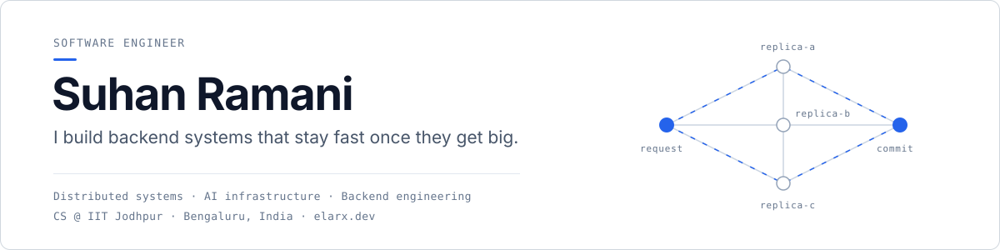

  
  
  
  
  
  

I'm a Computer Science undergrad at **IIT Jodhpur** working on **distributed systems, retrieval pipelines and AI infrastructure**. I care about the part of a system that breaks first under load, and I like to write down why it broke.

I build in public. Everything below is real work with real numbers, and I post what I learn while building it at [elarx.dev/writing](https://elarx.dev/writing) and on [X](https://x.com/SuhanRamani09).

> **Open to SDE and AI/ML internships.** The fastest way to reach me is [email](mailto:suhanramani@gmail.com).

 

## Featured work

| Project | What it does |
| :-- | :-- |
| **[CareQueue](https://github.com/Elarionitis/CareQueue)** `TypeScript` `Next.js` `React` `Risk modelling` | Continuous triage and waiting-room surveillance for emergency departments. In CDC's 2022 NHAMCS data, **45.8%** of critical outcomes came from patients triaged as low acuity. CareQueue scores risk from *outcomes* rather than nurse labels, and rules set a floor the model can only escalate. On held-out data it catches **56.7%** of critical outcomes vs **39.0%** for the baseline, and actions are logged to a SHA-256 hash chain for audit. Team lead, Team InnovX · Accenture Innovation Challenge, Round 2 |
| **[SignEase](https://github.com/Elarionitis/SignEase)** `TensorFlow` `MediaPipe` `FastAPI` `React` | Real-time ASL recognition from a webcam. Hand landmarks are extracted in the browser and sent as sequences to a Transformer behind a FastAPI inference service over WebSocket. **96%+** accuracy across 26 classes at **<100 ms per frame**. Quantisation made the model **4×** smaller and raised throughput by **40%**, for under 2% accuracy loss. [Live demo](https://sign-ease-eight.vercel.app) |
| **[Spendly](https://github.com/Elarionitis/Spendly)** `Flutter` `Dart` `Riverpod` `Firestore` | A shared expense tracker built as an **event-sourced, append-only ledger**. Balances are a fold over the event log, so concurrent edits can't conflict and no locks are needed. A min-cash-flow pass settles a group of *n* people in at most **n − 1** payments, up to **70%** fewer than paying everyone back pairwise. |
| **[Aeris](https://github.com/Elarionitis/aeris)** `Python` `XGBoost` `FastAPI` `React` `Docker` | Air-quality decision support: ward-level AQI forecasts up to 72 hours ahead with prediction intervals, NNLS source attribution (traffic, construction, industry, thermal), and a ranked list of sites to inspect. *Forecast → Explain → Prioritise → Act.* |

## Systems and tools

| Project | What it is | Stack |
| :-- | :-- | :-- |
| [**Repo Context MCP**](https://github.com/Elarionitis/repo-context-mcp) | MCP server that gives coding agents repository metadata, README content and stack signals as structured context | TypeScript · MCP SDK · GitHub API |
| [**Orbit**](https://github.com/Elarionitis/Orbit) | Multi-client TCP chat server with one thread per connection, shared state and broadcast | C++17 · POSIX sockets · CMake |
| [**LLVMShield**](https://github.com/Elarionitis/LLVMShield) | LLVM pass plugin with string encryption, bogus functions, symbol renaming and dead code. I built it to learn LLVM internals | C++ · LLVM · Python |
| [**OS Labs**](https://github.com/Elarionitis/OS) | Processes, scheduling, pthreads, semaphores, paging, and page replacement (FIFO / LRU / Optimal) | C · Linux |
| [**TradStrat**](https://github.com/Elarionitis/TradStrat) | Event-driven backtester with next-day-open execution, commission, drawdown and risk metrics | Python · Streamlit |
| [**elarx.dev**](https://github.com/Elarionitis/ElaRx) | My site and blog. Markdown posts, where publishing is a commit | Next.js 16 · React 19 · Tailwind v4 |

## Experience

**Software Development Engineer Intern** · Webify Design · *May – Jun 2026* 
Shipped features across 5+ production web apps. Fixed N+1 queries and reindexed MySQL on the busiest endpoints, cutting read latency by about **35%**.

**Student Developer** · SQORA (Winter of Code) · *Dec 2025 – Apr 2026* 
Built a RAG pipeline on Gemini and Qdrant: **500+** documents indexed with **sub-500 ms** end-to-end retrieval, async FastAPI ingestion, and validation that stopped every embedding failure seen in testing.

## Build log

What I've shipped recently, newest first. I post the longer write-ups at [elarx.dev/writing](https://elarx.dev/writing).

| When | What |
| :-- | :-- |
| Oct 2026 | Launched **[elarx.dev](https://elarx.dev)**, my site and engineering blog |
| Oct 2026 | Finished OS labs on paging, demand paging and page replacement |
| Oct 2026 | Updated SignEase's ASL recognition pipeline and frontend |
| Aug 2026 | Shipped the CareQueue prototype for the Accenture Innovation Challenge |
| Aug 2026 | Released Aeris, an AQI forecasting and attribution platform |

**Now:** operating system internals (xv6), memory hierarchy and cache behaviour, and making retrieval pipelines fast.

## Toolkit

**Languages:** C++ · C · Python · TypeScript · JavaScript · Java · Dart · SQL 
**Backend and infrastructure:** FastAPI · Node.js · PostgreSQL · MySQL · MongoDB · Firestore · Docker · Linux · AWS · Vercel 
**ML and AI:** TensorFlow · XGBoost · MediaPipe · RAG · Qdrant · Gemini API · MCP 
**Frontend and mobile:** React · Next.js · Tailwind · Flutter

## Outside the editor

- Overall Coordinator, **Anand Rathi Tinkerers' Lab**, IIT Jodhpur, the institute's 3,000+ sq. ft. makerspace
- Core team, **Programming Society**: I set 10+ contest problems on Codeforces Polygon and mentor juniors
- **JEE Advanced 2024: AIR 397** · 500+ competitive programming problems · [Codeforces](https://codeforces.com/profile/Suhan_Ramani) max rating 1319

 

Updated October 2026 · Reach me at <a href="mailto:suhanramani@gmail.com">suhanramani@gmail.com</a>
