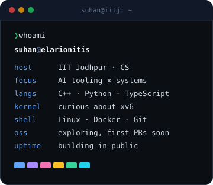
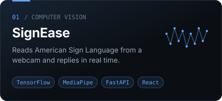
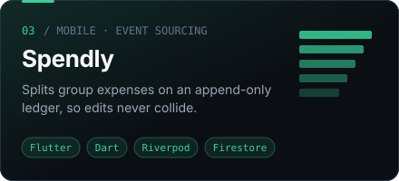
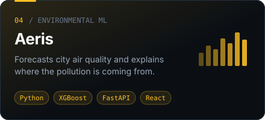
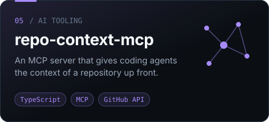
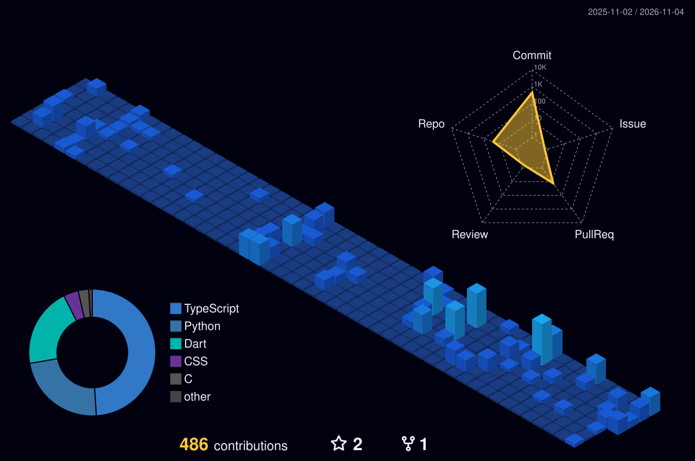

  
  
  
  
  

<table>
<tr>
<td width="58%" valign="top">

### Hey, I'm Suhan 👋

I study Computer Science at **IIT Jodhpur**. Most of what I build sits where **intelligent software meets the systems that run it**.

I care less about getting a feature to work and more about the machinery underneath: why the model is slow, where a socket blocks, what the kernel does when memory runs out.

Right now I'm moving from building my own projects to **contributing to open source** in the areas below. I'm building in public, so you'll see the learning as it happens.

`AI tooling` · `operating systems` · `distributed systems` · `Python & JS`

</td>
<td width="42%" valign="top">

</td>
</tr>
</table>

## Selected work

  
  

  
  

  
  

Also in the workshop: <a href="https://github.com/Elarionitis/LLVMShield">LLVMShield</a> (an LLVM pass I wrote to learn compiler internals) · <a href="https://github.com/Elarionitis/OS">OS labs</a> (scheduling, threads, paging in C) · <a href="https://github.com/Elarionitis/TradStrat">TradStrat</a> (an event-driven backtester)

## Toolbox

  
    
  
    
  

<table>
<tr>
<td width="50%" valign="top">

### 🔭 Currently exploring

**AI / LLM tooling** 
MCP servers, coding agents, and giving models the right context

**Operating systems** 
xv6, scheduling, memory, and what happens below the syscall

**Distributed systems** 
Consensus, replication, and staying correct when nodes fail

**Python & JS ecosystem** 
Reading the libraries I use and finding where I can help

</td>
<td width="50%" valign="top">

### 🛠️ Recently pushed

<!-- recent_repos starts -->
[ElaRx](https://github.com/Elarionitis/ElaRx) · Nov 11, 2026 My portfolio website

[SignEase](https://github.com/Elarionitis/SignEase) · Nov 9, 2026 SignEase is a real-time sign language recognition web application that lets…

[Orbit](https://github.com/Elarionitis/Orbit) · Nov 8, 2026 Orbit - A lightweight multi-client TCP chat application built in C++17 using…

[TradStrat](https://github.com/Elarionitis/TradStrat) · Nov 7, 2026 TradStrat is a Python-based trading strategy backtesting framework built to…

[OS](https://github.com/Elarionitis/OS) · Oct 27, 2026 Operating Systems lab work, assignments, and C implementations covering…

[CareQueue](https://github.com/Elarionitis/CareQueue) · Aug 30, 2026
<!-- recent_repos ends -->

Updated daily from my public repositories.

</td>
</tr>
</table>

## GitHub activity

### Build. Inspect. Break. Improve.

Computer Science · IIT Jodhpur · AI tooling · Systems · Open source

