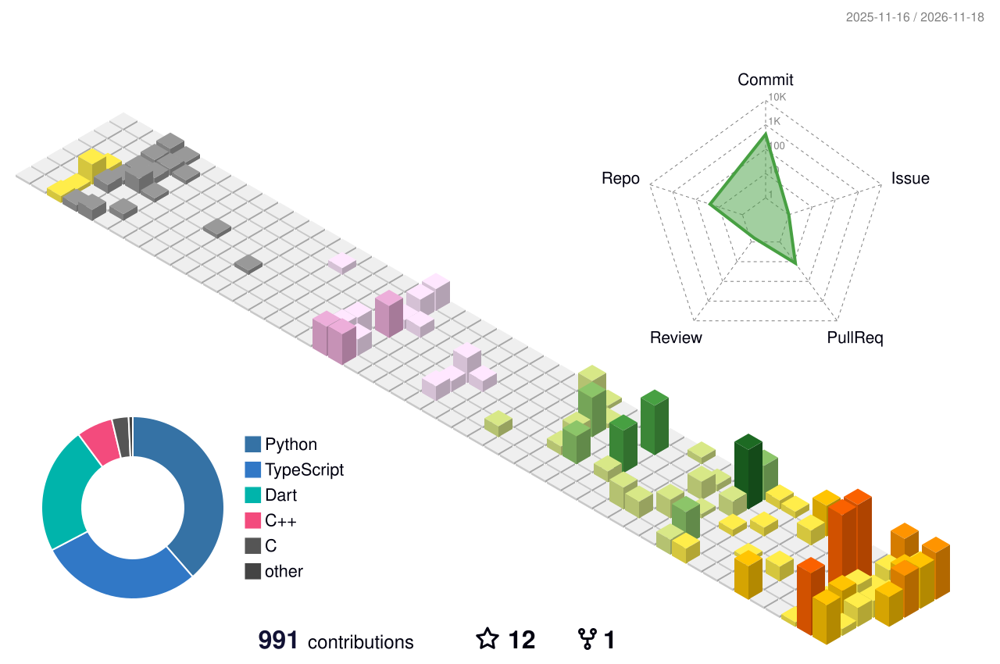

  
  <!--  -->
  
  
  
  
  <!--  -->
  

Hi, I'm Suhan, a CS undergrad at **IIT Jodhpur**. I work on **backend systems, retrieval pipelines and applied ML**, and I'm happiest when I can take something from the socket up, measure where it gets slow, and fix it.

Every project below ships with its numbers.

> [!TIP]
> **Open to SDE and AI/ML internships.** The fastest way to reach me is [email](mailto:suhanramani@gmail.com).

## Highlights

| Result | Context |
| :-- | :-- |
| ⚡ **17.4M deliveries/s** | Peak fan-out of Orbit, my C++ chat server, with p99 latency of 0.20 ms at 1,000 clients |
| 🩺 **56.7% vs 39.0%** | Critical ER patients CareQueue flags as urgent, against the triage level recorded at the time |
| 🤟 **250 signs, 87%** | SignEase's first-guess accuracy on signers the model had never seen |
| 🔎 **500+ docs, <0.5 s** | Retrieval I built for SQORA's AI answers with Gemini and Qdrant |
| 🚀 **~35% faster** | Busiest pages at Webify Design after fixing MySQL indexes and repeated queries |

## Featured work

| Project | What it does |
| :-- | :-- |
| **[Orbit](https://github.com/Elarionitis/Orbit)** `C++20` `epoll / kqueue` `OpenSSL` `CMake` | A sharded, durable, real-time chat server written from the socket up with no frameworks: its own event-loop reactor, binary wire protocol, write-ahead log and load generator. Rooms are sharded across threads with a single writer each, so **every member sees the same messages in the same order**, and with `--fsync always` an acknowledged message **survives `kill -9`**. Both guarantees are enforced by tests. Peaks at **17.4M deliveries/s**, with **p99 0.20 ms** at 1,000 clients. |
| **[SignEase](https://github.com/Elarionitis/SignEase)** `Next.js` `MediaPipe` `Flask` `TensorFlow Lite` | Sign in front of your webcam and it tells you the sign. **Hand tracking runs in the browser** (MediaPipe on WebAssembly + WebGL), and only landmark tensors go to the server, which fixed the CPU bottleneck in production. Frame-shape correction, signing-hand selection and calibrated confidence make webcam input match the training data. **250 signs, 87% top-1 and 96% top-3** on 3,247 recordings from unseen signers. [Live demo ↗](https://sign-ease-eight.vercel.app) |
| **[CareQueue](https://github.com/Elarionitis/CareQueue)** `TypeScript` `Next.js` `React` `Risk modelling` | Triage that keeps watching the waiting room. In the CDC's 2022 NHAMCS data, **45.8%** of critical outcomes came from patients triaged as lower acuity. CareQueue combines rules, an outcome-trained risk model and a consensus model, and re-scores patients while they wait. On **6,410** unseen visits it flags **56.7%** of critical patients as urgent, against **39.0%** for the original triage. Team lead, Team InnovX · Accenture Innovation Challenge, Round 2 |
| **[Spendly](https://github.com/Elarionitis/Spendly)** `Flutter` `Dart` `Riverpod` `Cloud Firestore` | A shared expense app where a whole group can edit at once without overwriting each other: **0 conflicts** in testing with five or more people editing. A min-cash-flow pass settles a group of *n* people in at most **n − 1** payments, up to **70%** fewer than paying back every debt one by one. |

## More projects

| Project | What it is | Stack |
| :-- | :-- | :-- |
| [**TradStrat**](https://github.com/Elarionitis/TradStrat) · [live ↗](https://tradstrat.streamlit.app) | A backtester built to prove your strategy wrong: tests 5 strategies on 6 ETFs (2007–2025) against buy-and-hold, with costs and luck accounted for | Python · pandas · Streamlit · Plotly |
| [**Aeris**](https://github.com/Elarionitis/aeris) | Ward-level AQI forecasts up to 72 hours ahead with prediction intervals, NNLS source attribution, and a ranked list of sites to inspect | Python · XGBoost · FastAPI · React · Docker |
| [**Repo Context MCP**](https://github.com/Elarionitis/repo-context-mcp) | MCP server that hands coding assistants a repository's metadata, README and stack as structured context | TypeScript · MCP SDK · GitHub API |
| [**LLVMShield**](https://github.com/Elarionitis/LLVMShield) | LLVM pass plugin for string encryption, bogus functions and symbol renaming, built to learn compiler internals | C++ · LLVM · Python |
| [**OS Labs**](https://github.com/Elarionitis/OS) | Processes, scheduling, pthreads, semaphores, paging and page replacement (FIFO / LRU / Optimal) | C · Linux |
| [**ElaRx**](https://github.com/Elarionitis/ElaRx) | My portfolio and engineering blog | Next.js · React · Tailwind |

## Experience

**Software Development Engineer Intern** · Webify Design · *May – Jun 2026* 
Built features for 5+ live client websites. Found and fixed missing MySQL indexes and repeated queries on the busiest pages, cutting their data load time by about **35%**, and added the logging that was missing on production sites.

**Student Developer** · SQORA, Winter of Code · *Dec 2025 – Apr 2026* 
Built the retrieval behind the platform's AI answers with Gemini and Qdrant: **500+** documents, results in **under half a second**. Made four ingestion jobs run concurrently with async FastAPI, and added checks so a failed document is reported instead of silently skipped.

## Toolkit

   
   
  

**Also:** SQL · Qdrant · Gemini API · RAG · MCP · MediaPipe · XGBoost · Riverpod · CMake · Git · REST APIs

## Achievements

- **JEE Advanced 2024**: rank 397 in the GEN-EWS category list 
- **GUJCET 2024**: state rank 3
- **JEE Main 2024**: 99.55 percentile 

## Recently shipped

<!-- recent_repos starts -->
[repo-context-mcp](https://github.com/Elarionitis/repo-context-mcp) · Nov 16, 2026 Lightweight MCP server that fetches GitHub repository context and converts it…

[TradStrat](https://github.com/Elarionitis/TradStrat) · Nov 15, 2026 Backtest a trading idea on real prices, then find out whether to believe it…

[ElaRx](https://github.com/Elarionitis/ElaRx) · Nov 15, 2026 My portfolio website

[SignEase](https://github.com/Elarionitis/SignEase) · Nov 9, 2026 SignEase is a real-time sign language recognition web application that lets…

[Orbit](https://github.com/Elarionitis/Orbit) · Nov 8, 2026 Orbit - A lightweight multi-client TCP chat application built in C++17 using…

[OS](https://github.com/Elarionitis/OS) · Oct 27, 2026 Operating Systems lab work, assignments, and C implementations covering…
<!-- recent_repos ends -->

Updated daily from my public repositories.

<b>Contribution graph</b>

 
<picture>
  <source media="(prefers-color-scheme: dark)" srcset="./profile-3d-contrib/profile-night-view.svg">
  
</picture>

 

> *“Excellence is a continuous process and not an accident.”* 
> — Dr. A.P.J. Abdul Kalam

Updated November 2026 · Reach me at <a href="mailto:suhanramani@gmail.com">suhanramani@gmail.com</a>
